<p align="center">
  <picture>
    <source media="(prefers-color-scheme: dark)" srcset="public/peel-logo-horizontal-dark-1600.png">
    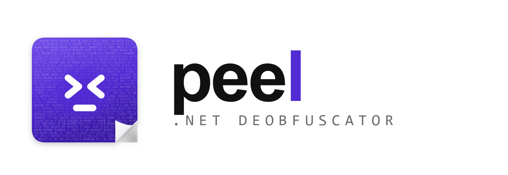
  </picture>
</p>

<p align="center">
  <b>Peel the obfuscation off .NET assemblies, right in your browser.</b><br>
  Open source · MIT · free forever · your files never leave your device
</p>

<p align="center">
  <a href="README.tr.md">Türkçe</a> ·
  <a href="#quick-start">Quick start</a> ·
  <a href="#example">Example</a> ·
  <a href="#features">Features</a> ·
  <a href="#command-line">CLI</a> ·
  <a href="#how-it-works">How it works</a> ·
  <a href="#safety-model">Safety</a> ·
  <a href="#honest-limits">Limits</a>
</p>

<p align="center">
  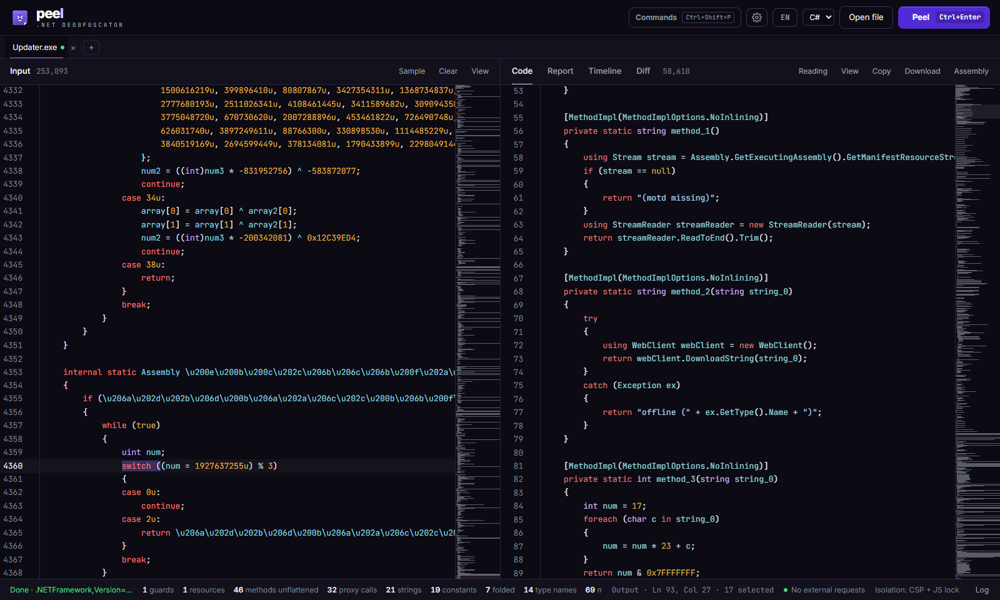
</p>

---

## What is PEEL?

PEEL is a .NET deobfuscator. Open an obfuscated `.exe` or `.dll`, press **Peel** (`Ctrl + Enter`), and you get readable C#
back, the cleaned assembly, and a report of what the code actually does.

Obfuscators such as ConfuserEx hide a program behind encrypted strings and constants, a `switch` state machine in every method,
proxy methods in front of every call, encrypted resources, anti-debug checks and unreadable names. PEEL takes those apart the way
an analyst would, but it does it inside a sandbox and checks every step:

- **It is a real .NET runtime, in WebAssembly.** The engine is written in C# on [dnlib](https://github.com/0xd4d/dnlib) (MIT)
  and the [ILSpy](https://github.com/icsharpcode/ILSpy) decompiler engine, `ICSharpCode.Decompiler` (MIT), compiled to
  WebAssembly with the .NET 10 SDK. It runs in a Web Worker in the browser and in a locked-down child process in Node.
- **It runs the decryptors instead of guessing them.** String and constant decryptors are called inside the sandbox, from a
  trampoline in the same assembly (so `GetCallingAssembly` checks pass), and their results are written back as constants.
- **It never performs side effects.** Before anything runs, the assembly is copied and every network, file, process, registry,
  P/Invoke and `Assembly.Load` call is redirected to a recorder. `Environment.Exit` stops the run, not the sandbox.
- **It proves its own changes.** After every pass the module is written, re-read and every method body is re-parsed. If the
  program can run, its entry point and up to 40 static methods are executed again; output, exception, attempted side effects
  and probe results must match the original or the pass is rolled back.
- **It tells you what the code does.** Detected obfuscator and techniques with evidence, a threat score, the side effects the
  code attempted, IOCs (URLs, domains, IPs, Discord webhooks, Telegram bots), and assemblies it tried to load from memory,
  which you can download or peel in a new tab.
- **It stays on your machine.** No server, no telemetry, no upload. The status bar counts every external request the page makes.

One button runs everything.

## Quick start

You need Node.js 25+ and the **.NET 10 SDK** (to build the WebAssembly engine; no extra workloads are needed).

```bash
git clone https://github.com/LLCForge/Peel-NET.git
cd Peel-NET
npm install
npm run dev
```

`npm run dev` builds the engine into `public/engine/` (about 15 MB of WebAssembly and IL, first time only) and starts Vite.
Open <http://localhost:5173>, drop an `.exe` or `.dll` onto the page or click **Try the sample assembly**, then press **Peel**.

To build a static site you can host anywhere:

```bash
npm run build
```

`dist/` is the whole app, including the engine and a `_headers` file with the sandbox CSP for Netlify and Cloudflare Pages. It
also works offline as a PWA after the first visit.

## Screenshots

<table>
  <tr>
    <td width="50%">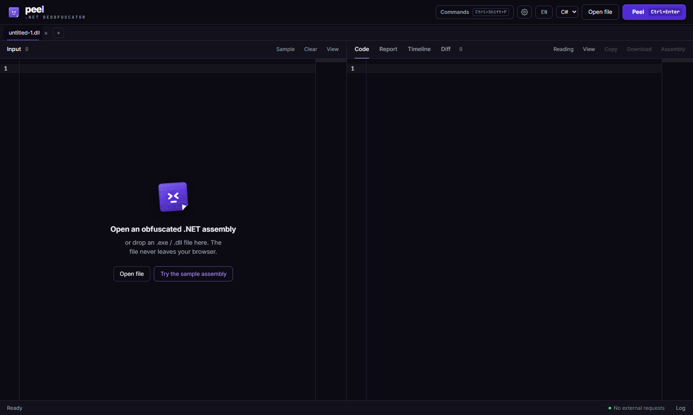<br><sub><b>Start screen.</b> Open or drop an assembly (or a folder), or try the sample.</sub></td>
    <td width="50%">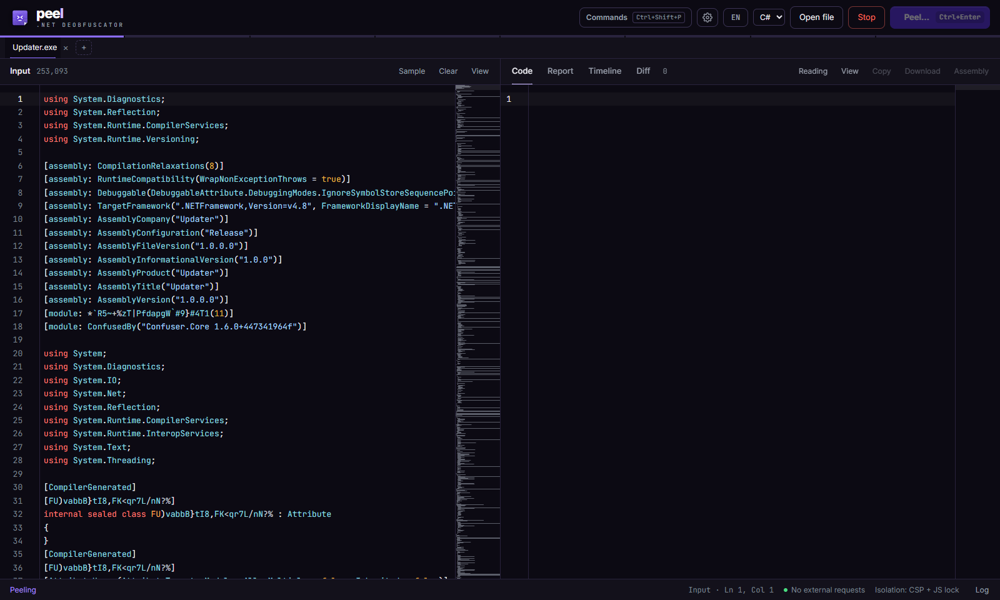<br><sub><b>Input.</b> The original assembly, decompiled as-is: flattened <code>switch</code> state machines and invisible names.</sub></td>
  </tr>
  <tr>
    <td>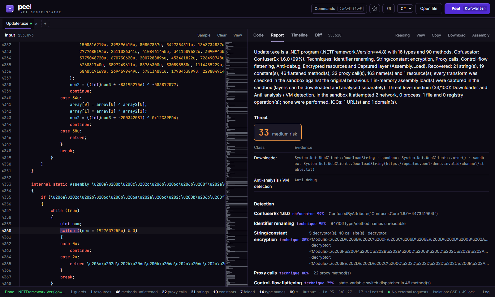<br><sub><b>Report.</b> Summary, threat score with evidence, detected obfuscator and techniques, sandbox behaviour, IOCs, layers, metrics.</sub></td>
    <td>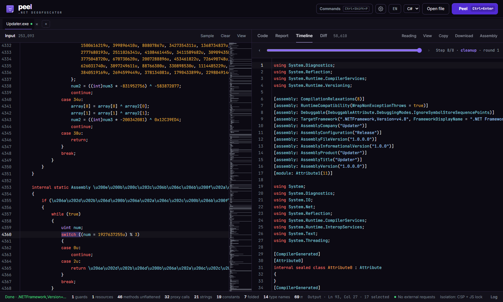<br><sub><b>Timeline.</b> Scrub through the C# after every accepted pass.</sub></td>
  </tr>
  <tr>
    <td>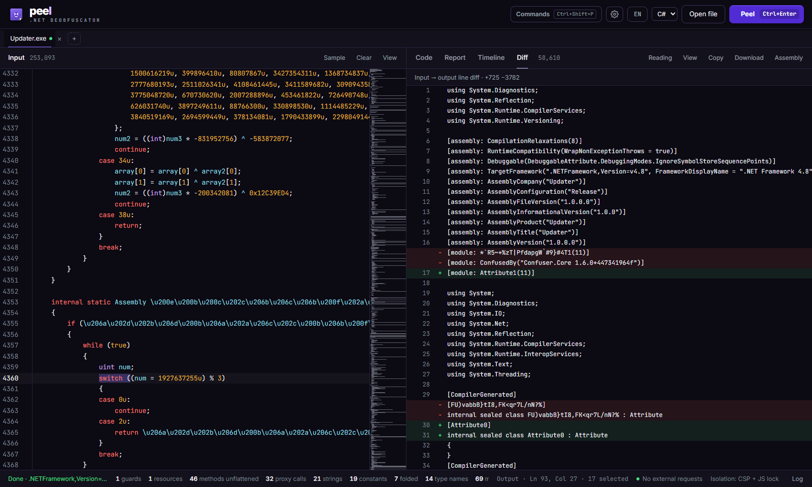<br><sub><b>Diff.</b> What changed between the original and the cleaned C#.</sub></td>
    <td>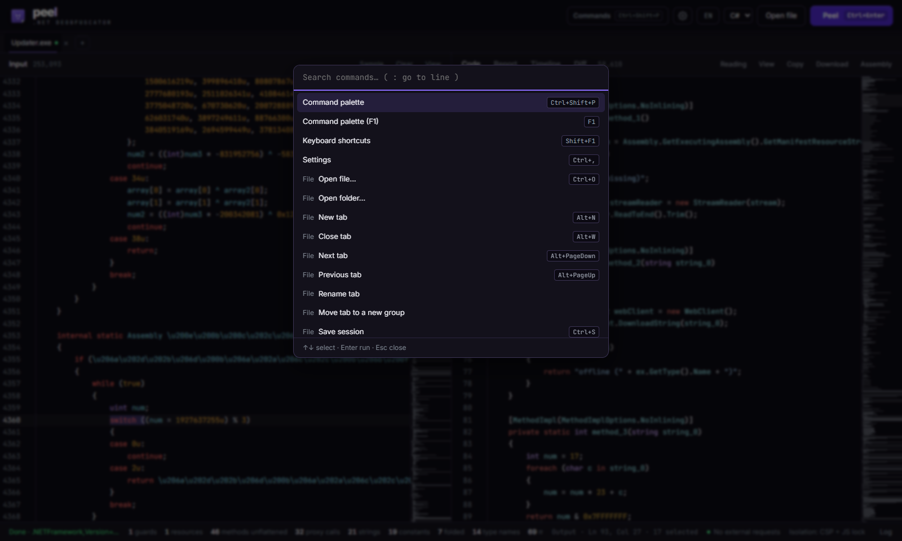<br><sub><b>Command palette.</b> Every action, searchable (<code>Ctrl + Shift + P</code>).</sub></td>
  </tr>
  <tr>
    <td colspan="2">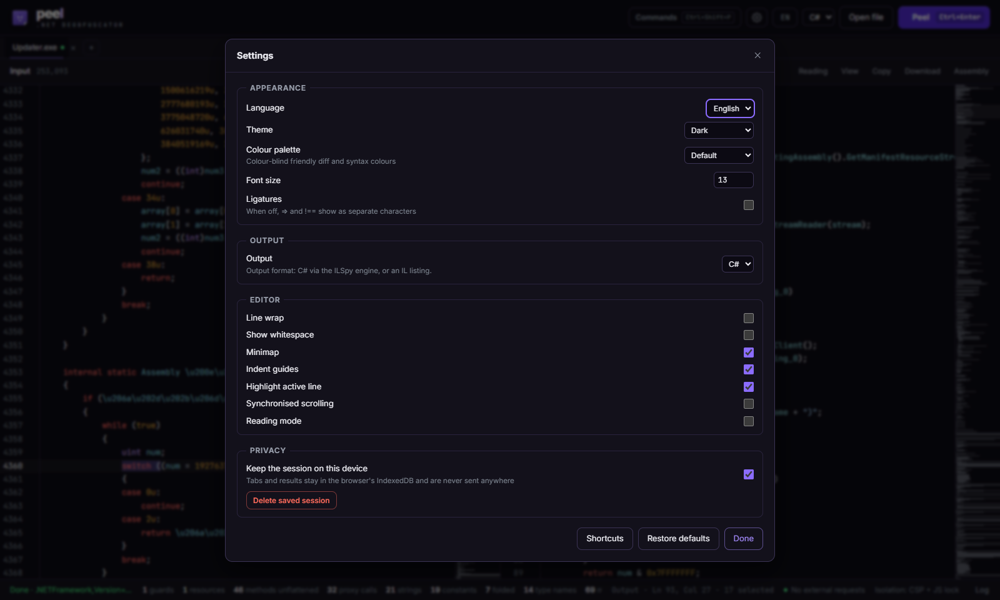<br><sub><b>Settings.</b> Language, theme, colour-blind palettes, output (C# or IL), editor options and session storage.</sub></td>
  </tr>
</table>

<p align="center">
  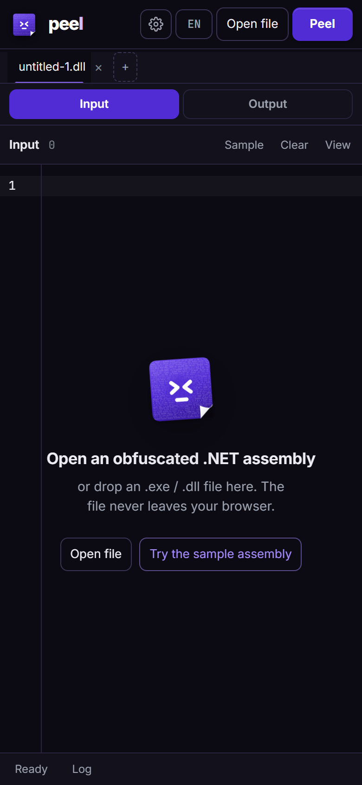<br>
  <sub>The interface also works on a phone.</sub>
</p>

The sample in these screenshots is [`samples/Updater`](samples/Updater), a harmless console program, protected with ConfuserEx 2
(constants, control flow, reference proxy, renaming, anti debug and resources). It reads an embedded text, decodes a Base64
string, checks for a file and tries to download a text file from `updates.peel-demo.invalid` (a domain that cannot resolve). In
the sandbox the download and the file check are only recorded; the report shows both.

## Example

What the protected `Main` looks like when you decompile it directly (names shortened with `…`, they are 41 invisible
characters each):

```csharp
private static void \u200f\u200d\u200f…(string[] P_0)
{
    \u200e\u200f\u200d…(\u206c\u206b\u202e…());
    string text = \u206a\u206f\u202a…(<Module>.\u202d\u206b\u202c…<string>(399434219));
    int num3 = default(int);
    string text3 = default(string);
    while (true)
    {
        int num = 1698603537;
        while (true)
        {
            uint num2;
            switch ((num2 = (uint)(num ^ 0x20BB3827)) % 11)
            {
            case 9u:
                text3 = \u200b\u200b\u206e…(<Module>.\u206e\u200c\u202e…<string>(-1888611479));
                num = 1411009009;
                continue;
            case 1u:
                \u200e\u200f\u200d…(\u202a\u200d\u202e…(<Module>.\u206a\u202b\u202d…<string>(-1709542101), text));
                num = 1089213690;
                continue;
            // … 9 more cases
```

What PEEL returns, after `antidebug`, `resources`, `controlflow`, `proxy`, `strings`, `fold`, `rename` and `cleanup`, every
one of them checked against the original's behaviour in the sandbox:

```csharp
private static void Main(string[] stringArray_0)
{
    Console.WriteLine(method_1());
    string text = method_0("Y29uZmlnOiBjaGFubmVsPXN0YWJsZTsgcmV0cmllcz0z");
    Console.WriteLine("Config -> " + text);
    Console.WriteLine(File.Exists(Path.Combine(Environment.GetFolderPath((SpecialFolder)28), "PeelDemo", "installed.flag")) ? "Already installed" : "Fresh install");
    string text2 = method_2("https://updates.peel-demo.invalid/channel/stable.txt");
    Console.WriteLine("Latest: " + ((text2.Length == 0) ? "unknown" : text2));
    Console.WriteLine("Checksum: " + method_3(text));
    for (int i = 0; i < 3; i++)
    {
        Console.WriteLine("Step " + (i + 1) + "/3 " + ((i == 2) ? "done" : "..."));
    }
}
```

The original names are gone for good (ConfuserEx does not keep them), so PEEL gives readable, typed placeholders (`method_1`,
`string_0`, `Class3`). The cleaned assembly is a normal .NET assembly: the `greeter-full` fixture, cleaned this way, runs on the
.NET Framework with exactly the original output.

## Features

### Obfuscators

| Obfuscator | What PEEL does |
|---|---|
| **ConfuserEx / ConfuserEx 2** (and forks that keep `ConfusedByAttribute`) | constants (strings, numbers, primitives), control flow (switch mode), reference proxy (mild), resources, anti debug, anti ildasm, renaming: decoded. Anti tamper: detected and reported, not decrypted. |
| **Obfuscar** | hidden strings (the GUID-named string class) and renaming: decoded. |
| **Eazfuscator.NET**, **.NET Reactor**, **SmartAssembly**, **Dotfuscator** | detected by their markers. Eazfuscator and Dotfuscator are not blocked: the generic passes (string decryptors with constant integer keys, renaming) are tried and verified, nothing more is promised. .NET Reactor and SmartAssembly are commercial protectors and are reported only. |
| **Babel (VM)**, **Agile.NET (CliSecure)**, **ArmDot**, **VMProtect** (managed and native), **Themida / WinLicense**, **KoiVM**, **DNGuard HVM**, **Crypto Obfuscator**, **MaxtoCode**, **Enigma**, **UPX** | detected and reported only. The file is not changed: bypassing commercial protection is out of scope. |
| **Costura.Fody**, embedded PE resources | reported (embedded assemblies are listed). |

### Passes

| Pass | What it does |
|---|---|
| `antidebug` | removes calls to anti-debug and anti-dump initialisers from the module initializer (`<Module>..cctor`) |
| `resources` | runs the resource initializer in the sandbox, captures the hidden assembly it loads and puts its resources back into the module |
| `controlflow` | rebuilds ConfuserEx switch-flattened methods: a path-sensitive simulation computes the real target of every edge into the dispatcher and links it directly; the dispatcher then becomes dead code and is removed |
| `proxy` | replaces calls to proxy methods (a body that only forwards its arguments to one call) with the real call, `callvirt` or `newobj` |
| `strings` | finds decryptor methods (by what they reference and where they live), evaluates their constant arguments, calls them in the sandbox and writes the results back as `ldstr` / `ldc` |
| `fold` | folds constant arithmetic and constant conditional branches (opaque predicates) |
| `rename` | gives unreadable identifiers (invisible characters, private-use and CJK noise, `#=` names, GUID names, Obfuscar's short names) typed names; virtual methods, interface implementations and P/Invoke keep theirs; WinForms resources move with their type |
| `cleanup` | removes obfuscator marker attributes (`ConfusedByAttribute`, `SuppressIldasmAttribute`, ...) and their unused types |

Passes repeat in rounds until nothing changes. The output is C# from the ILSpy engine (or an IL listing, switchable in the
header), plus the cleaned assembly. Method tokens are preserved, so the assembly stays loadable and comparable.

### Analysis report

- **Detection**: obfuscator with version, techniques, confidence and evidence; commercial protection is marked "report only".
- **Threat**: a 0-100 score with classes and evidence: process injection (P/Invoke), reflective loading, dropper, downloader,
  process execution, keylogging, screen capture, browser and wallet data theft, persistence, Discord/Telegram exfiltration,
  antivirus tampering, ransomware behaviour, anti-analysis. The obfuscator's own runtime code is not counted against the
  program.
- **Behaviour**: the network, process, file and registry calls the program attempted in the sandbox, with arguments.
- **IOCs**: URLs, domains, IPs, e-mail addresses, Discord webhooks, Telegram bots, download hosts; version strings such as
  `1.0.0.0` and Microsoft/schema domains are filtered out.
- **Layers**: assemblies the code tried to load with `Assembly.Load(byte[])`, with size and content; download them or peel them in
  a new tab.
- **Metrics** and a **summary** in Turkish or English.

### Interface

The same interface as the other PEEL tools: tabs and folders, a CodeMirror editor with C# highlighting, folding, search and a
minimap, report, timeline and diff views, a command palette, shortcuts, light/dark/high-contrast themes, colour-blind palettes,
Turkish and English, sessions stored in IndexedDB (export and import as JSON), offline PWA, and a mobile layout.

## Command line

```bash
npx peel-net app.exe                   # C# to stdout, summary to stderr
npx peel-net app.exe -o app.cs -a app.clean.exe -r report.json
npx peel-net samples/ -d out/ -r reports.json
npx peel-net - --json < app.dll        # stdin, JSON report to stdout
npx peel-net app.exe --il --layers layers/ --fail-on high
```

| Option | Meaning |
|---|---|
| `-o, --out <file>` | write the C# (or IL) to a file |
| `-d, --out-dir <dir>` | write outputs for a directory input (structure kept) |
| `-a, --assembly <file>` | write the cleaned assembly |
| `--il` | IL listing instead of C# |
| `-r, --report <json\|text\|file>` | report to stdout or to a file (`.txt` gives text) |
| `--layers <dir>` | write captured `Assembly.Load` layers |
| `--only <pass,...>` | run only these passes |
| `--lang tr\|en` | report language |
| `--fail-on <level>` | exit code 4 when the threat level reaches `low`, `medium`, `high` or `critical` |

Exit codes: 0 ok, 1 error, 2 usage error, 4 threshold reached.

## Library

```js
import { peel, deobfuscate, analyze, close } from 'peel-net';
import { readFileSync, writeFileSync } from 'node:fs';

const r = await peel(readFileSync('app.exe'), { lang: 'en' });
console.log(r.report.summary);
writeFileSync('app.cs', r.code);          // C#
writeFileSync('app.clean.exe', r.bytes);  // cleaned assembly
await close();                            // stop the sandbox process
```

`deobfuscate()` returns the same without the report; `analyze()` builds a report from engine results. The report format is
documented at the top of [`src/core/analyze.js`](src/core/analyze.js).

## How it works

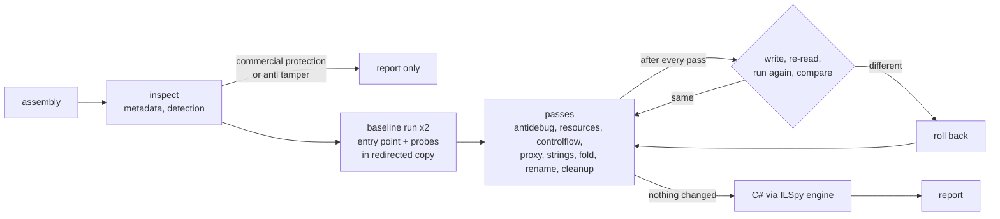

| Folder | Contents |
|---|---|
| `engine/` | the C# engine: inspection and detection, sandbox copy and runner, passes, control-flow solver, renaming, decompiler bridge |
| `src/core/` | pipeline (rounds, verification, rollback), pass order, report assembly |
| `src/sandbox/` | watchdog, Web Worker and Node hosts, message handler |
| `src/report/` | detection translation, threat rules, IOCs, summary, text report |
| `src/ui/` | the web interface |
| `src/cli/`, `bin/` | the CLI |
| `samples/` | harmless C# sample programs used to build the fixtures |
| `scripts/` | engine build, fixture generator (ConfuserEx 2 runner, Obfuscar) |
| `test/` | fixtures and unit tests |

**Choice of tooling.** The engine needs to read and rewrite .NET metadata and IL, execute decryptors, and decompile. Doing
that in JavaScript would mean writing a metadata writer, an IL emulator and a decompiler from scratch. Instead PEEL compiles
proven, MIT-licensed .NET libraries to WebAssembly with the standard `Microsoft.NET.Sdk.WebAssembly` SDK: `dnlib 4.5.0` for
metadata and IL, `ICSharpCode.Decompiler 9.1` for C#, and the .NET runtime itself (Mono interpreter) to run decryptors and
behaviour checks. de4dot was not used: it is GPL-3.0 and would not fit an MIT project.

## Safety model

Peel runs code from the file you give it, so the sandbox is layered:

- **Redirected copy.** Sample code never runs as it is. A copy is made with dnlib in which every call to the network
  (`System.Net.*`), files (`File`, `Directory`, `FileStream`...), processes, the registry, WMI, services, clipboard, message boxes,
  P/Invoke methods and `Assembly.Load*` is replaced by a stub that records the call and returns a harmless value
  (empty string, empty array, memory stream). Constructors with side effects (a `FileStream` on a path, a `TcpClient` to a host)
  are never called. `Environment.Exit` and `FailFast` end the run with an exception. Assemblies loaded from memory are captured
  as layers and loaded as their own redirected copies. Anti-debug initialisers are cut off.
- **A .NET runtime without an operating system.** The runtime is WebAssembly: there is no real file system, no P/Invoke into
  native code and no sockets. The sample is loaded into a collectible `AssemblyLoadContext` that is discarded after the run.
- **Node (CLI, tests, library).** The engine runs in a child process started with `node --permission` that may read only the
  engine files and the sandbox scripts; file writes, network, child processes and workers are denied by the operating system.
- **Browser.** The engine runs in a Web Worker with its own Content Security Policy from the response header
  (`default-src 'none'; script-src 'self' 'wasm-unsafe-eval'; connect-src 'self'`). Once the engine has loaded, the worker removes
  `fetch`, `XMLHttpRequest`, `WebSocket`, `EventSource`, `WebTransport`, `importScripts`, nested workers, `caches`, `indexedDB`,
  `BroadcastChannel`, `eval`, the `Function` constructors and string timers. The status bar shows which layers are active; hosts
  that cannot set headers (GitHub Pages) only get the JavaScript lock, and the status bar says so.
- **Watchdog.** Every request has a deadline (20 s for a run, 120 s for a pass or loading the engine). A worker or process that
  hangs or crashes is killed and replaced; the pipeline is stateless and carries on. **Stop** kills everything immediately.
- **Fixtures are encoded on disk.** Obfuscated test assemblies are stored XOR + base64 encoded so antivirus software does not
  flag the repository, and are decoded only in memory. Raw obfuscated files only ever exist in a temporary folder while
  `npm run fixtures` builds them.

## Honest limits

- **Commercial protection is not cracked.** .NET Reactor, SmartAssembly, Babel VM, Agile.NET, ArmDot, VMProtect, Themida/WinLicense,
  KoiVM, DNGuard and similar are detected and reported; the file is left unchanged.
- **ConfuserEx anti tamper is detected, not decrypted.** Method bodies are encrypted and decrypted by the module initializer
  with pointer arithmetic on the mapped image, which the WebAssembly runtime cannot reproduce. Such files are reported only.
- **ConfuserEx reference proxy in strong mode** (delegates in static fields) is detected but not resolved; mild mode is.
- **Control flow**: the ConfuserEx switch mode is solved. Other flattening schemes and ConfuserEx's predicate variants that are
  not plain constants are left as they are (the log names the method).
- **Original names are lost** in renaming obfuscators; PEEL gives typed placeholders, not the real names. Virtual methods and
  interface implementations keep their obfuscated names.
- **Eazfuscator.NET and .NET Reactor** are detected; only the generic passes are tried on them and they are not part of the test
  suite, because their outputs cannot be produced without the commercial tools.
- **Behaviour verification needs something to run.** For an `.exe` the entry point is run; for a `.dll`, up to 40 static methods
  with primitive or string parameters are probed with fixed arguments. Code that needs WinForms/WPF, real files, network
  responses or Windows-only APIs may not run in the WebAssembly runtime; then only structural checks are done and the result is
  marked as not verified. Values captured at run time cover the paths that ran.
- **The decryptor search is heuristic.** It looks for static methods with primitive parameters that use decoding APIs or live in
  the obfuscator's runtime; a decryptor that does not look like one is missed (and left in place, never broken).
- Mixed-mode (C++/CLI) assemblies are inspected and decompiled, but native code is not.
- The browser engine is about 15 MB (3-4 MB compressed); the first run downloads it once. A run in the browser is several times
  slower than in Node (the sample takes 15-30 s in the browser, about 3 s in Node).

## Tests

```bash
npm test                          # 12 fixtures through the whole pipeline, then 5 unit test files
node test/run.js updater-full     # one fixture with its log and summary (add --code for the C#)
npm run fixtures                  # rebuild the fixtures (Windows, .NET SDK, .NET Framework 4.8)
```

Fixtures are the harmless programs in [`samples/`](samples) built with the .NET SDK and protected with open-source obfuscators,
ConfuserEx 2 (`Confuser.MSBuild` 1.6.0, MIT; run through the small [`scripts/fixtures/CrRunner`](scripts/fixtures/CrRunner)) and
Obfuscar 2.2.50 (MIT): constants, control flow, reference proxy, renaming, everything at once with anti debug and anti ildasm,
resources, anti tamper (detection only), a DLL with constants, a DLL with Obfuscar, commercial marker attributes (detection
only), and an in-memory loader. Each fixture's expectations (strings that must appear in the C#, detections, attempted side
effects, captured layers, behaviour verification, no rollbacks) are in the `.json` next to it. The unit tests cover the report
and threat rules, the CLI, translations, the browser path and CSP, and the sandbox (side effects recorded and not performed,
layer capture, watchdog restart).

## Contributing

Issues and pull requests are welcome. If you have an assembly PEEL does not handle, please open an issue with a small, harmless
program that reproduces it, protected with an open-source obfuscator. A pull request that adds a fixture proving the fix is the
fastest way to get it merged. Please do not attach real malware or third-party commercial software.

## License

[MIT](LICENSE). Free to use, change and redistribute, including commercially. There is no paid tier, no account and no telemetry.
Third-party components keep their own licences: dnlib (MIT), ICSharpCode.Decompiler (MIT), the .NET runtime (MIT); the fixture
tools ConfuserEx 2 and Obfuscar are MIT and are not shipped.
