<p align="center">
  <picture>
    <source media="(prefers-color-scheme: dark)" srcset="public/peel-logo-horizontal-dark-1600.png">
    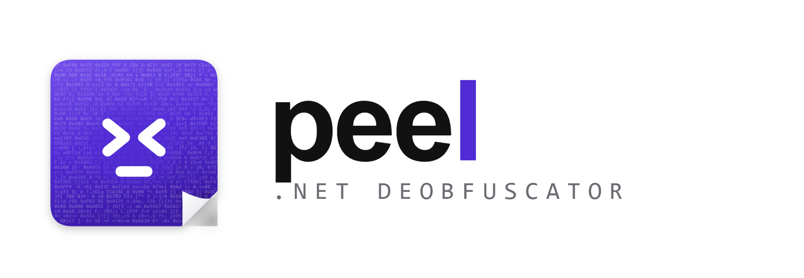
  </picture>
</p>

<p align="center">
  <b>.NET derlemelerindeki gizlemeyi doğrudan tarayıcında soy.</b><br>
  Açık kaynak · MIT · sonsuza dek ücretsiz · dosyaların cihazından çıkmaz
</p>

<p align="center">
  <a href="README.md">English</a> ·
  <a href="#hızlı-başlangıç">Hızlı başlangıç</a> ·
  <a href="#örnek">Örnek</a> ·
  <a href="#özellikler">Özellikler</a> ·
  <a href="#komut-satırı">CLI</a> ·
  <a href="#nasıl-çalışır">Nasıl çalışır</a> ·
  <a href="#güvenlik-modeli">Güvenlik</a> ·
  <a href="#dürüst-sınırlar">Sınırlar</a>
</p>

<p align="center">
  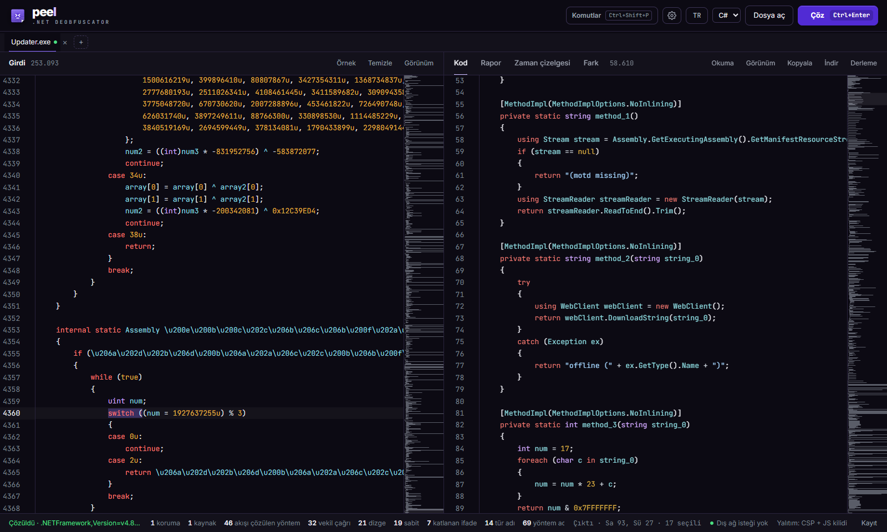
</p>

---

## PEEL nedir?

PEEL bir .NET deobfuscator'ıdır. Gizlenmiş bir `.exe` ya da `.dll` aç, **Çöz**'e bas (`Ctrl + Enter`); okunur C#, temizlenmiş
derleme ve kodun gerçekte ne yaptığını anlatan bir rapor alırsın.

ConfuserEx gibi gizleyiciler programı şifreli dizgelerin ve sabitlerin, her yöntemde bir `switch` durum makinesinin, her
çağrının önüne konan vekil yöntemlerin, şifreli kaynakların, anti-debug denetimlerinin ve okunamaz adların arkasına saklar.
PEEL bunları bir analistin yapacağı gibi söker, ama bunu bir sandbox içinde yapar ve her adımı doğrular:

- **Gerçek bir .NET çalışma zamanı, WebAssembly içinde.** Motor C# ile [dnlib](https://github.com/0xd4d/dnlib) (MIT) ve
  [ILSpy](https://github.com/icsharpcode/ILSpy) ayrıştırıcı motoru `ICSharpCode.Decompiler` (MIT) üzerine yazılmış, .NET 10
  SDK ile WebAssembly'ye derlenmiştir. Tarayıcıda Web Worker'da, Node'da kilitli bir alt süreçte çalışır.
- **Çözücüleri tahmin etmez, çalıştırır.** Dizge ve sabit çözücüleri sandbox içinde, aynı derlemedeki bir trambolinden
  çağrılır (böylece `GetCallingAssembly` denetimleri geçer); sonuçları sabit olarak yerine yazılır.
- **Hiçbir yan etkiyi gerçekleştirmez.** Bir şey çalışmadan önce derlemenin bir kopyası alınır ve tüm ağ, dosya, süreç, kayıt
  defteri, P/Invoke ve `Assembly.Load` çağrıları bir kaydediciye yönlendirilir. `Environment.Exit` sandbox'ı değil yalnızca
  çalıştırmayı bitirir.
- **Kendi değişikliklerini kanıtlar.** Her geçişten sonra modül yazılır, yeniden okunur ve tüm yöntem gövdeleri yeniden
  ayrıştırılır. Program çalışabiliyorsa giriş noktası ve en fazla 40 statik yöntem yeniden çalıştırılır; çıktı, istisna,
  denenen yan etkiler ve yoklama sonuçları özgünle aynı olmalıdır, değilse geçiş geri alınır.
- **Kodun ne yaptığını söyler.** Kanıtlarıyla tespit edilen gizleyici ve teknikler, tehdit puanı, kodun denediği yan etkiler,
  IOC'ler (URL, alan adı, IP, Discord webhook, Telegram botu) ve bellekten yüklemeye çalıştığı derlemeler (indirilebilir ya da
  yeni sekmede çözülebilir).
- **Cihazından çıkmaz.** Sunucu, telemetri ya da yükleme yok. Durum çubuğu sayfanın yaptığı her dış isteği sayar.

Tek düğme her şeyi çalıştırır.

## Hızlı başlangıç

Node.js 25+ ve **.NET 10 SDK** gerekir (WebAssembly motorunu derlemek için; ek iş yükü gerekmez).

```bash
git clone https://github.com/LLCForge/Peel-NET.git
cd Peel-NET
npm install
npm run dev
```

`npm run dev` motoru `public/engine/` altına derler (yaklaşık 15 MB WebAssembly ve IL, yalnızca ilk sefer) ve Vite'ı başlatır.
<http://localhost:5173> adresini aç, bir `.exe` ya da `.dll` dosyasını sayfaya bırak ya da **Örnek derlemeyle dene**'ye tıkla,
sonra **Çöz**'e bas.

Her yerde barındırılabilen statik site üretmek için:

```bash
npm run build
```

`dist/` uygulamanın tamamıdır; motor ve Netlify / Cloudflare Pages için sandbox CSP'sini içeren `_headers` dosyası dahil. İlk
ziyaretten sonra PWA olarak çevrimdışı da çalışır.

## Ekran görüntüleri

<table>
  <tr>
    <td width="50%">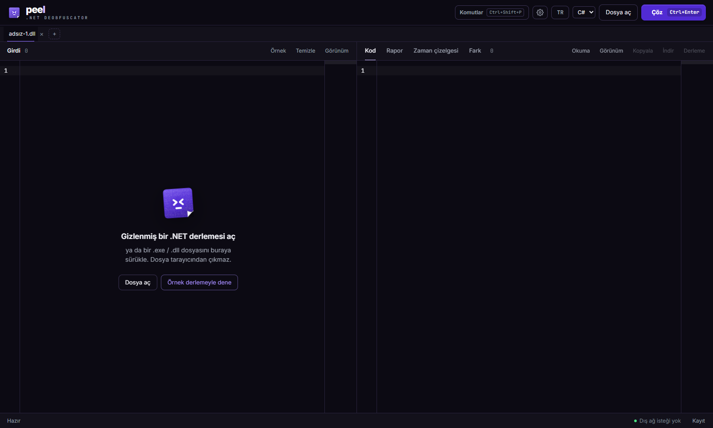<br><sub><b>Başlangıç.</b> Bir derleme (ya da klasör) aç veya bırak, ya da örneği dene.</sub></td>
    <td width="50%">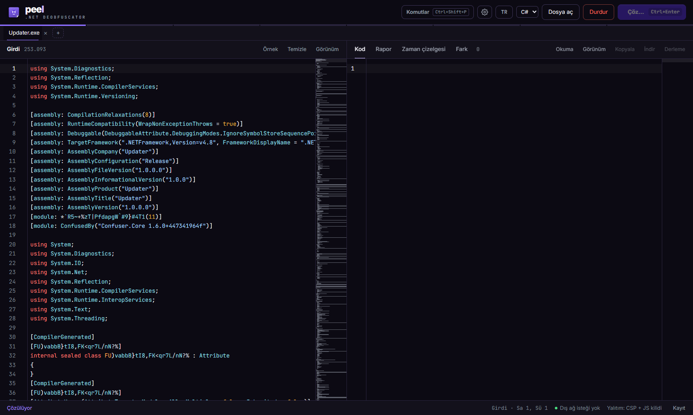<br><sub><b>Girdi.</b> Özgün derleme olduğu gibi ayrıştırılmış: düzleştirilmiş <code>switch</code> durum makineleri ve görünmez adlar.</sub></td>
  </tr>
  <tr>
    <td>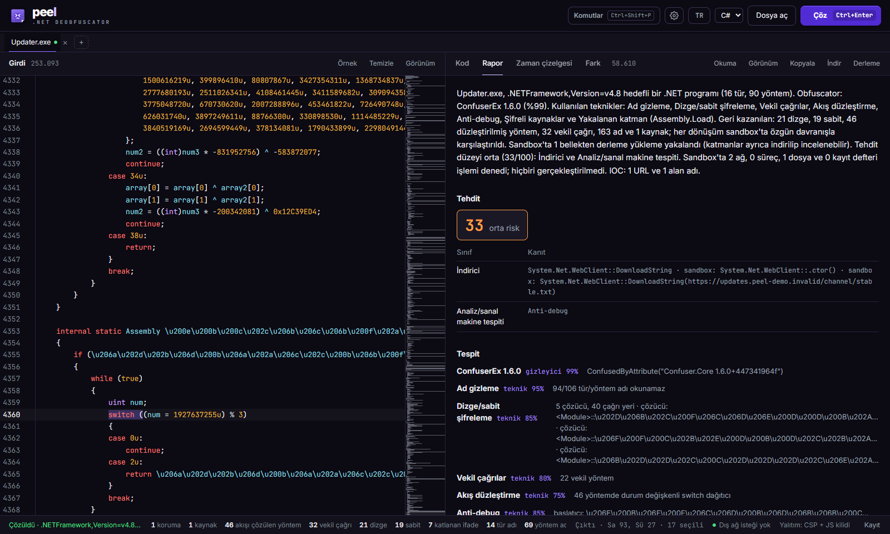<br><sub><b>Rapor.</b> Özet, kanıtlı tehdit puanı, tespit edilen gizleyici ve teknikler, sandbox davranışı, IOC, katmanlar, ölçümler.</sub></td>
    <td>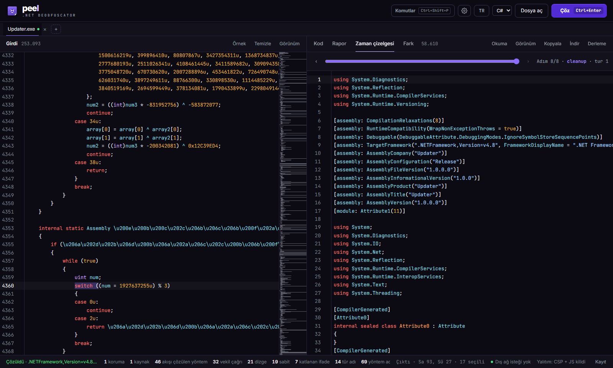<br><sub><b>Zaman çizelgesi.</b> Kabul edilen her geçişten sonraki C# hâlinde gezin.</sub></td>
  </tr>
  <tr>
    <td>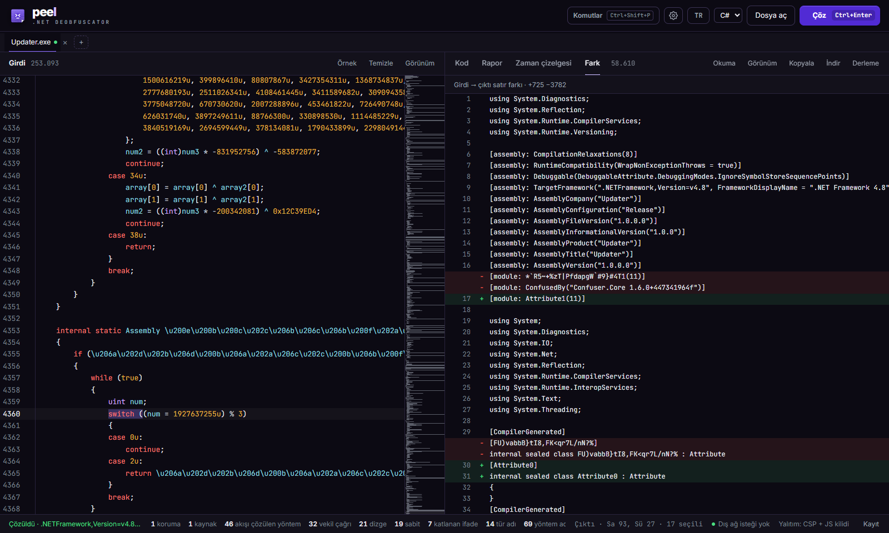<br><sub><b>Fark.</b> Özgün ve temizlenmiş C# arasında neyin değiştiği.</sub></td>
    <td>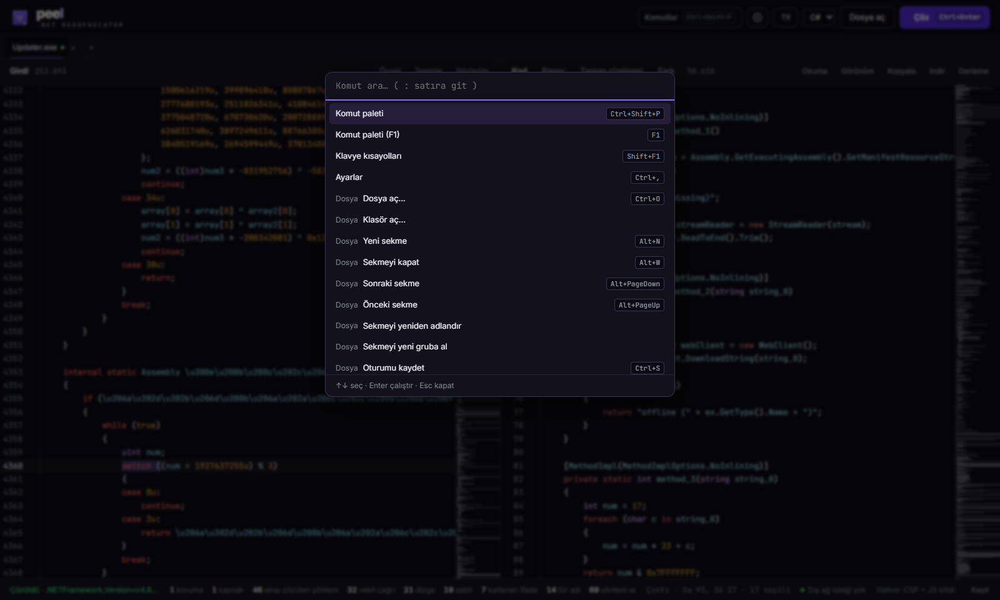<br><sub><b>Komut paleti.</b> Tüm eylemler, aranabilir (<code>Ctrl + Shift + P</code>).</sub></td>
  </tr>
  <tr>
    <td colspan="2">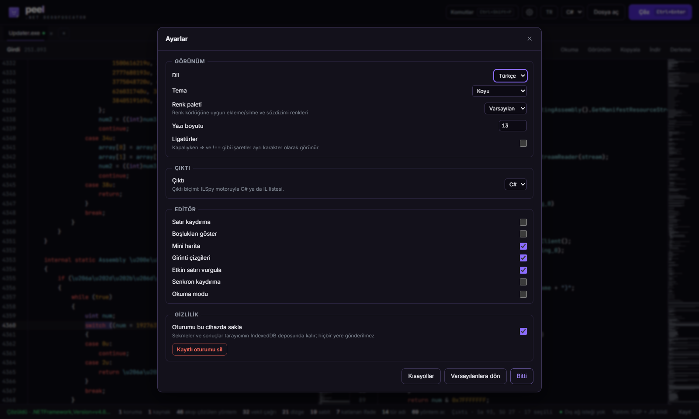<br><sub><b>Ayarlar.</b> Dil, tema, renk körlüğü paletleri, çıktı (C# ya da IL), editör seçenekleri ve oturum kaydı.</sub></td>
  </tr>
</table>

<p align="center">
  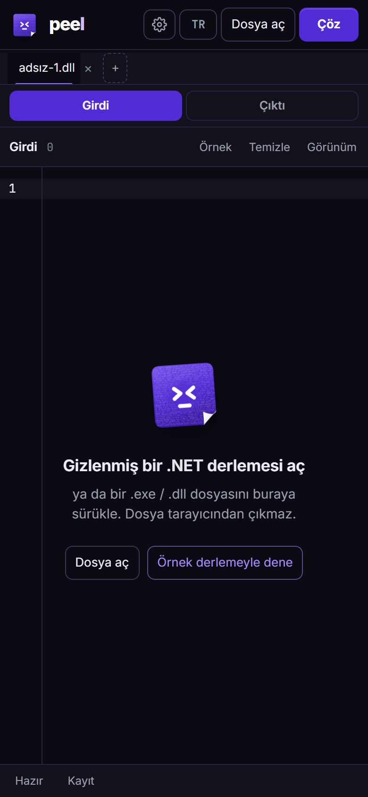<br>
  <sub>Arayüz telefonda da çalışır.</sub>
</p>

Ekran görüntülerindeki örnek, zararsız bir konsol programı olan [`samples/Updater`](samples/Updater)'ın ConfuserEx 2 ile
(constants, control flow, reference proxy, renaming, anti debug, resources) korunmuş hâlidir. Gömülü bir metni okur, bir
Base64 dizgesini çözer, bir dosyanın varlığını denetler ve `updates.peel-demo.invalid` adresinden (çözülemeyen bir alan adı) bir
metin indirmeye çalışır. Sandbox'ta indirme ve dosya denetimi yalnızca kaydedilir; rapor ikisini de gösterir.

## Örnek

Korunan `Main`'in doğrudan ayrıştırıldığında görünüşü (adlar `…` ile kısaltıldı; her biri 41 görünmez karakter):

```csharp
private static void \u200f\u200d\u200f…(string[] P_0)
{
    \u200e\u200f\u200d…(\u206c\u206b\u202e…());
    string text = \u206a\u206f\u202a…(<Module>.\u202d\u206b\u202c…<string>(399434219));
    int num3 = default(int);
    string text3 = default(string);
    while (true)
    {
        int num = 1698603537;
        while (true)
        {
            uint num2;
            switch ((num2 = (uint)(num ^ 0x20BB3827)) % 11)
            {
            case 9u:
                text3 = \u200b\u200b\u206e…(<Module>.\u206e\u200c\u202e…<string>(-1888611479));
                num = 1411009009;
                continue;
            case 1u:
                \u200e\u200f\u200d…(\u202a\u200d\u202e…(<Module>.\u206a\u202b\u202d…<string>(-1709542101), text));
                num = 1089213690;
                continue;
            // … 9 durum daha
```

PEEL'in döndürdüğü; `antidebug`, `resources`, `controlflow`, `proxy`, `strings`, `fold`, `rename` ve `cleanup` geçişlerinden
sonra, her biri sandbox'ta özgün davranışla karşılaştırılarak:

```csharp
private static void Main(string[] stringArray_0)
{
    Console.WriteLine(method_1());
    string text = method_0("Y29uZmlnOiBjaGFubmVsPXN0YWJsZTsgcmV0cmllcz0z");
    Console.WriteLine("Config -> " + text);
    Console.WriteLine(File.Exists(Path.Combine(Environment.GetFolderPath((SpecialFolder)28), "PeelDemo", "installed.flag")) ? "Already installed" : "Fresh install");
    string text2 = method_2("https://updates.peel-demo.invalid/channel/stable.txt");
    Console.WriteLine("Latest: " + ((text2.Length == 0) ? "unknown" : text2));
    Console.WriteLine("Checksum: " + method_3(text));
    for (int i = 0; i < 3; i++)
    {
        Console.WriteLine("Step " + (i + 1) + "/3 " + ((i == 2) ? "done" : "..."));
    }
}
```

Özgün adlar kalıcı olarak kaybolmuştur (ConfuserEx onları saklamaz); PEEL okunur, türüne göre yer tutucu adlar verir
(`method_1`, `string_0`, `Class3`). Temizlenmiş derleme sıradan bir .NET derlemesidir: `greeter-full` fixture'ı bu şekilde
temizlendiğinde .NET Framework üzerinde özgünüyle birebir aynı çıktıyı verir.

## Özellikler

### Gizleyiciler

| Gizleyici | PEEL ne yapar |
|---|---|
| **ConfuserEx / ConfuserEx 2** (ve `ConfusedByAttribute` işaretini koruyan çatallar) | constants (dizge, sayı, ilkel türler), control flow (switch kipi), reference proxy (mild), resources, anti debug, anti ildasm, renaming: çözülür. Anti tamper: tespit edilir ve raporlanır, şifresi çözülmez. |
| **Obfuscar** | gizlenmiş dizgeler (GUID adlı dizge sınıfı) ve yeniden adlandırma: çözülür. |
| **Eazfuscator.NET**, **.NET Reactor**, **SmartAssembly**, **Dotfuscator** | işaretlerinden tanınır. Eazfuscator ve Dotfuscator engellenmez: genel geçişler (sabit tamsayı anahtarlı dizge çözücüleri, yeniden adlandırma) denenir ve doğrulanır, fazlası vaat edilmez. .NET Reactor ve SmartAssembly ticari korumalardır, yalnızca raporlanır. |
| **Babel (VM)**, **Agile.NET (CliSecure)**, **ArmDot**, **VMProtect** (yönetilen ve yerel), **Themida / WinLicense**, **KoiVM**, **DNGuard HVM**, **Crypto Obfuscator**, **MaxtoCode**, **Enigma**, **UPX** | yalnızca tespit edilir ve raporlanır. Dosya değiştirilmez: ticari korumayı aşmak kapsam dışıdır. |
| **Costura.Fody**, gömülü PE kaynakları | raporlanır (gömülü derlemeler listelenir). |

### Geçişler

| Geçiş | Ne yapar |
|---|---|
| `antidebug` | modül başlatıcısındaki (`<Module>..cctor`) anti-debug ve anti-dump başlatıcı çağrılarını kaldırır |
| `resources` | kaynak başlatıcısını sandbox'ta çalıştırır, yüklediği gizli derlemeyi yakalar ve kaynaklarını modüle geri koyar |
| `controlflow` | ConfuserEx'in switch ile düzleştirdiği yöntemleri yeniden kurar: yol duyarlı benzetim dağıtıcıya giren her kenarın gerçek hedefini hesaplar ve kenarı doğrudan oraya bağlar; dağıtıcı ölü kod olur ve silinir |
| `proxy` | vekil yöntem çağrılarını (gövdesi yalnızca argümanlarını tek bir çağrıya aktaran) gerçek `call`, `callvirt` ya da `newobj` ile değiştirir |
| `strings` | çözücü yöntemleri (başvurdukları API'ler ve bulundukları yere göre) bulur, sabit argümanlarını hesaplar, sandbox'ta çağırır ve sonuçları `ldstr` / `ldc` olarak geri yazar |
| `fold` | sabit aritmetiği ve sabit koşullu dalları (opak yüklemler) katlar |
| `rename` | okunamaz tanımlayıcılara (görünmez karakterler, özel kullanım ve CJK gürültüsü, `#=` adları, GUID adları, Obfuscar'ın kısa adları) türüne göre ad verir; sanal yöntemler, arayüz uygulamaları ve P/Invoke adlarını korur; WinForms kaynakları türleriyle birlikte taşınır |
| `cleanup` | gizleyici işaret özniteliklerini (`ConfusedByAttribute`, `SuppressIldasmAttribute` ...) ve kullanılmayan türlerini kaldırır |

Geçişler değişiklik durana kadar turlar hâlinde tekrarlanır. Çıktı ILSpy motorundan C# (ya da başlıktan seçilebilen IL listesi)
ve temizlenmiş derlemedir. Yöntem belirteçleri korunur; derleme yüklenebilir ve karşılaştırılabilir kalır.

### Analiz raporu

- **Tespit**: sürümüyle gizleyici, teknikler, güven ve kanıt; ticari korumalar "yalnızca rapor" olarak işaretlenir.
- **Tehdit**: sınıfları ve kanıtlarıyla 0-100 puan: süreç enjeksiyonu (P/Invoke), bellekten yükleme, dropper, indirici, süreç
  çalıştırma, tuş kaydı, ekran görüntüsü, tarayıcı ve cüzdan verisi çalma, kalıcılık, Discord/Telegram sızdırma, antivirüs
  ayarlarını değiştirme, fidye yazılımı davranışı, analiz tespiti. Gizleyicinin kendi çalışma zamanı kodu programın aleyhine
  sayılmaz.
- **Davranış**: programın sandbox'ta argümanlarıyla denediği ağ, süreç, dosya ve kayıt defteri çağrıları.
- **IOC**: URL, alan adı, IP, e-posta, Discord webhook, Telegram botu, indirme sunucuları; `1.0.0.0` gibi sürüm dizgeleri ve
  Microsoft/şema alanları ayıklanır.
- **Katmanlar**: kodun `Assembly.Load(byte[])` ile yüklemeye çalıştığı derlemeler, boyut ve içerikleriyle; indir ya da yeni
  sekmede çöz.
- **Ölçümler** ve Türkçe ya da İngilizce **özet**.

### Arayüz

Diğer PEEL araçlarıyla aynı arayüz: sekmeler ve klasörler, C# renklendirmesi, katlama, arama ve mini haritalı CodeMirror
editörü, rapor, zaman çizelgesi ve fark görünümleri, komut paleti, kısayollar, açık/koyu/yüksek kontrast temalar, renk körlüğü
paletleri, Türkçe ve İngilizce, IndexedDB'de oturum (JSON olarak dışa/içe aktarım), çevrimdışı PWA ve mobil yerleşim.

## Komut satırı

```bash
npx peel-net app.exe                   # C# stdout'a, özet stderr'e
npx peel-net app.exe -o app.cs -a app.clean.exe -r rapor.json
npx peel-net samples/ -d out/ -r raporlar.json
npx peel-net - --json < app.dll        # stdin, JSON rapor stdout'a
npx peel-net app.exe --il --layers katmanlar/ --fail-on high
```

| Seçenek | Anlamı |
|---|---|
| `-o, --out <dosya>` | C# (ya da IL) çıktısını dosyaya yaz |
| `-d, --out-dir <dizin>` | dizin girdisinin çıktıları (yapı korunur) |
| `-a, --assembly <dosya>` | temizlenmiş derlemeyi yaz |
| `--il` | C# yerine IL listesi |
| `-r, --report <json\|text\|dosya>` | rapor stdout'a ya da dosyaya (`.txt` metin verir) |
| `--layers <dizin>` | yakalanan `Assembly.Load` katmanlarını yaz |
| `--only <geçiş,...>` | yalnızca bu geçişler |
| `--lang tr\|en` | rapor dili |
| `--fail-on <düzey>` | tehdit düzeyi `low`, `medium`, `high` ya da `critical` eşiğine ulaşırsa çıkış kodu 4 |

Çıkış kodları: 0 tamam, 1 hata, 2 kullanım hatası, 4 eşiğe ulaşıldı.

## Kütüphane

```js
import { peel, deobfuscate, analyze, close } from 'peel-net';
import { readFileSync, writeFileSync } from 'node:fs';

const r = await peel(readFileSync('app.exe'), { lang: 'tr' });
console.log(r.report.summary);
writeFileSync('app.cs', r.code);          // C#
writeFileSync('app.clean.exe', r.bytes);  // temizlenmiş derleme
await close();                            // sandbox sürecini kapat
```

`deobfuscate()` aynısını rapor olmadan döndürür; `analyze()` motor sonuçlarından rapor üretir. Rapor biçimi
[`src/core/analyze.js`](src/core/analyze.js) dosyasının başında anlatılır.

## Nasıl çalışır

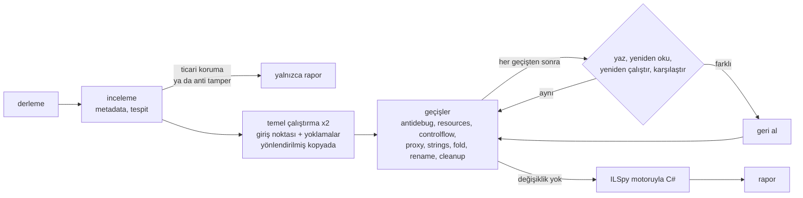

| Dizin | İçerik |
|---|---|
| `engine/` | C# motoru: inceleme ve tespit, sandbox kopyası ve çalıştırıcı, geçişler, akış çözücüsü, yeniden adlandırma, ayrıştırıcı köprüsü |
| `src/core/` | hat (turlar, doğrulama, geri alma), geçiş sırası, rapor derleme |
| `src/sandbox/` | bekçi, Web Worker ve Node sunucuları, ileti işleyicisi |
| `src/report/` | tespit çevirisi, tehdit kuralları, IOC, özet, metin rapor |
| `src/ui/` | web arayüzü |
| `src/cli/`, `bin/` | CLI |
| `samples/` | fixture'ları üretmek için kullanılan zararsız C# örnek programlar |
| `scripts/` | motor derlemesi, fixture üretici (ConfuserEx 2 çalıştırıcısı, Obfuscar) |
| `test/` | fixture'lar ve birim testleri |

**Araç seçimi.** Motorun .NET metadata ve IL'ini okuyup yeniden yazması, çözücüleri çalıştırması ve C#'a ayrıştırması gerekir.
Bunu JavaScript'te yapmak sıfırdan bir metadata yazıcısı, IL öykünücüsü ve ayrıştırıcı yazmak demekti. Bunun yerine PEEL,
kendini kanıtlamış MIT lisanslı .NET kütüphanelerini standart `Microsoft.NET.Sdk.WebAssembly` SDK'sıyla WebAssembly'ye derler:
metadata ve IL için `dnlib 4.5.0`, C# için `ICSharpCode.Decompiler 9.1`, çözücüleri ve davranış denetimlerini çalıştırmak için
.NET çalışma zamanının kendisi (Mono yorumlayıcısı). de4dot kullanılmadı: GPL-3.0'dır ve MIT bir projeye uymaz.

## Güvenlik modeli

PEEL verdiğin dosyanın kodunu çalıştırır; sandbox bu yüzden katmanlıdır:

- **Yönlendirilmiş kopya.** Örnek kod hiçbir zaman olduğu gibi çalışmaz. dnlib ile bir kopya üretilir; bu kopyada ağ
  (`System.Net.*`), dosya (`File`, `Directory`, `FileStream`...), süreç, kayıt defteri, WMI, servis, pano, mesaj kutusu,
  P/Invoke ve `Assembly.Load*` çağrıları, çağrıyı kaydedip zararsız bir değer (boş dizge, boş dizi, bellek akışı) döndüren
  taslaklarla değiştirilir. Yan etkili kurucular (bir yola açılan `FileStream`, bir sunucuya bağlanan `TcpClient`) hiç
  çağrılmaz. `Environment.Exit` ve `FailFast` çalıştırmayı bir istisnayla bitirir. Bellekten yüklenen derlemeler katman olarak
  yakalanır ve kendi yönlendirilmiş kopyalarıyla yüklenir. Anti-debug başlatıcıları kesilir.
- **İşletim sistemi olmayan bir .NET çalışma zamanı.** Çalışma zamanı WebAssembly'dir: gerçek dosya sistemi, yerel koda
  P/Invoke ve soket yoktur. Örnek, çalıştırmadan sonra atılan toplanabilir bir `AssemblyLoadContext`'e yüklenir.
- **Node (CLI, testler, kütüphane).** Motor `node --permission` ile başlatılan, yalnızca motor dosyalarını ve sandbox
  betiklerini okuyabilen bir alt süreçte çalışır; dosya yazma, ağ, alt süreç ve worker işletim sistemi düzeyinde engellidir.
- **Tarayıcı.** Motor, yanıt başlığından kendi Content Security Policy'sini alan bir Web Worker'da çalışır
  (`default-src 'none'; script-src 'self' 'wasm-unsafe-eval'; connect-src 'self'`). Motor yüklendikten sonra worker
  `fetch`, `XMLHttpRequest`, `WebSocket`, `EventSource`, `WebTransport`, `importScripts`, iç içe worker, `caches`, `indexedDB`,
  `BroadcastChannel`, `eval`, `Function` kurucuları ve dizge zamanlayıcılarını kaldırır. Durum çubuğu hangi katmanların etkin
  olduğunu gösterir; başlık veremeyen barındırmalar (GitHub Pages) yalnızca JavaScript kilidini alır ve durum çubuğu bunu söyler.
- **Bekçi.** Her isteğin bir son tarihi vardır (çalıştırma için 20 sn, geçiş ya da motor yükleme için 120 sn). Kilitlenen ya da
  çöken worker veya süreç öldürülüp yenisi başlatılır; hat durumsuzdur, kaldığı yerden sürer. **Durdur** her şeyi hemen keser.
- **Fixture'lar diskte kodludur.** Gizlenmiş test derlemeleri antivirüs depoyu işaretlemesin diye XOR + base64 kodlu saklanır ve
  yalnızca bellekte çözülür. Ham gizlenmiş dosyalar yalnızca `npm run fixtures` onları üretirken geçici bir dizinde bulunur.

## Dürüst sınırlar

- **Ticari koruma kırılmaz.** .NET Reactor, SmartAssembly, Babel VM, Agile.NET, ArmDot, VMProtect, Themida/WinLicense, KoiVM,
  DNGuard ve benzerleri tespit edilip raporlanır; dosya değiştirilmez.
- **ConfuserEx anti tamper tespit edilir, şifresi çözülmez.** Yöntem gövdeleri şifrelidir ve modül başlatıcısı tarafından
  eşlenmiş görüntü üzerinde işaretçi aritmetiğiyle çözülür; WebAssembly çalışma zamanı bunu yeniden üretemez. Bu dosyalar
  yalnızca raporlanır.
- **ConfuserEx reference proxy strong kipi** (statik alanlardaki temsilciler) tespit edilir ama çözülmez; mild kipi çözülür.
- **Akış**: ConfuserEx switch kipi çözülür. Başka düzleştirme şemaları ve ConfuserEx'in düz sabit olmayan yüklem çeşitleri
  olduğu gibi bırakılır (günlük, yöntemin adını yazar).
- **Özgün adlar kaybolmuştur.** Yeniden adlandıran gizleyicilerde PEEL gerçek adları değil türüne göre yer tutucuları verir.
  Sanal yöntemler ve arayüz uygulamaları gizlenmiş adlarını korur.
- **Eazfuscator.NET ve .NET Reactor** tespit edilir; üzerlerinde yalnızca genel geçişler denenir ve test takımında yer almazlar,
  çünkü çıktıları ticari araçlar olmadan üretilemez.
- **Davranış doğrulaması için çalıştırılacak bir şey gerekir.** `.exe` için giriş noktası çalıştırılır; `.dll` için ilkel ya da
  dizge parametreli en fazla 40 statik yöntem sabit argümanlarla yoklanır. WinForms/WPF, gerçek dosya, ağ yanıtı ya da yalnızca
  Windows'ta bulunan API gerektiren kod WebAssembly çalışma zamanında çalışmayabilir; bu durumda yalnızca yapısal denetim
  yapılır ve sonuç doğrulanmadı olarak işaretlenir. Çalışma anında yakalanan değerler yalnızca çalışan yolları kapsar.
- **Çözücü araması sezgiseldir.** Kod çözme API'lerini kullanan ya da gizleyicinin çalışma zamanında bulunan ilkel parametreli
  statik yöntemlere bakar; çözücüye benzemeyen bir çözücü kaçırılır (yerinde bırakılır, asla bozulmaz).
- Karma kip (C++/CLI) derlemeler incelenir ve ayrıştırılır, ama yerel kod ayrıştırılmaz.
- Tarayıcı motoru yaklaşık 15 MB'tır (sıkıştırılmış 3-4 MB); ilk çalıştırmada bir kez indirilir. Tarayıcıda bir çözme Node'dan
  birkaç kat yavaştır (örnek tarayıcıda 15-30 sn, Node'da yaklaşık 3 sn).

## Testler

```bash
npm test                          # 12 fixture tam hattan geçer, ardından 5 birim test dosyası
node test/run.js updater-full     # tek fixture, günlüğü ve özetiyle (C# için --code ekle)
npm run fixtures                  # fixture'ları yeniden üret (Windows, .NET SDK, .NET Framework 4.8)
```

Fixture'lar, [`samples/`](samples) altındaki zararsız programların .NET SDK ile derlenip açık kaynak gizleyicilerle korunmuş
hâlleridir: ConfuserEx 2 (`Confuser.MSBuild` 1.6.0, MIT; küçük [`scripts/fixtures/CrRunner`](scripts/fixtures/CrRunner) ile
çalıştırılır) ve Obfuscar 2.2.50 (MIT). Kapsam: constants, control flow, reference proxy, renaming, anti debug ve anti ildasm ile
hepsi birden, resources, anti tamper (yalnızca tespit), constants'lı bir DLL, Obfuscar'lı bir DLL, ticari işaret öznitelikleri
(yalnızca tespit) ve bellekten yükleyen bir yükleyici. Her fixture'ın beklentileri (C#'ta bulunması gereken dizgeler, tespitler,
denenen yan etkiler, yakalanan katmanlar, davranış doğrulaması, geri alma olmaması) yanındaki `.json` dosyasındadır. Birim
testleri raporu ve tehdit kurallarını, CLI'yi, çevirileri, tarayıcı yolunu ve CSP'yi, sandbox'ı (yan etkiler kaydedilir ama
yapılmaz, katman yakalama, bekçi yeniden başlatması) kapsar.

## Katkı

Konu ve çekme istekleri memnuniyetle karşılanır. PEEL'in çözemediği bir derleme varsa, sorunu yeniden üreten, açık kaynak bir
gizleyiciyle korunmuş küçük ve zararsız bir programla konu aç. Düzeltmeyi kanıtlayan bir fixture ekleyen çekme isteği en hızlı
birleştirilendir. Lütfen gerçek zararlı yazılım ya da üçüncü taraf ticari yazılım ekleme.

## Lisans

[MIT](LICENSE). Ticari kullanım dahil özgürce kullan, değiştir ve dağıt. Ücretli katman, hesap ya da telemetri yok. Üçüncü taraf
bileşenler kendi lisanslarını korur: dnlib (MIT), ICSharpCode.Decompiler (MIT), .NET çalışma zamanı (MIT); fixture araçları
ConfuserEx 2 ve Obfuscar MIT'tir ve dağıtılmaz.
